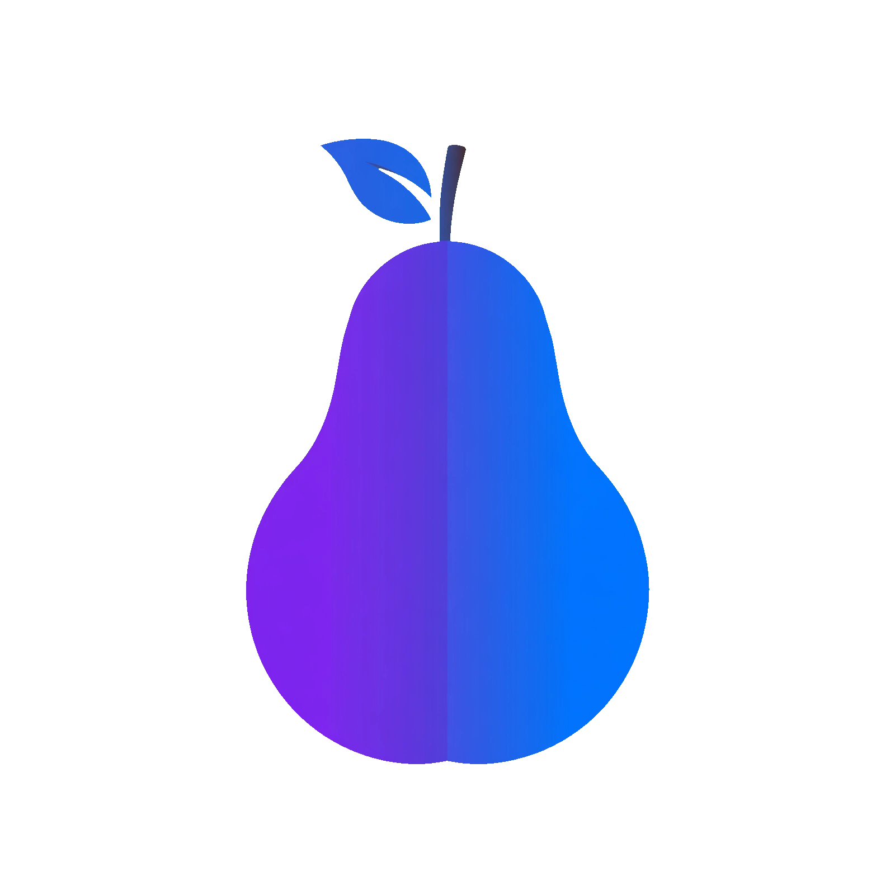

<p align="center"></p>

<h1 align="center">PearSilicon</h1>

<p align="center">A native macOS library for iOS, Mac and Windows apps on Apple silicon.</p>

<p align="center">
  <a href="https://pearsilicon.pages.dev">Website</a> ·
  <a href="https://github.com/denizomer10/PearSilicon/releases">Downloads</a> ·
  <a href="docs/CLI.md">CLI reference</a> ·
  <a href="docs/ARCHITECTURE.md">Architecture</a> ·
  <a href="https://discord.gg/yRVC5ZCyby">Discord</a>
</p>

PearSilicon brings the software you already own into a SwiftUI library. Switch between **iOS Apps**, **Mac Apps** and **Wine Apps** at the top of the window. Keep the library on your Mac or a connected drive, with saves, input profiles and backups managed alongside your apps.

## Requirements

- An Apple silicon Mac running **macOS 26 or later**.
- A compatible copy of the application you want to import. Device-built iOS apps must have an unencrypted executable. PearSilicon does not decrypt App Store binaries.
- Apple Command Line Tools for preparation paths that use `otool` and `install_name_tool`. x86_64 Wine engines also require Rosetta 2.

## Install and get started

1. Download `PearSilicon.zip` from [GitHub Releases](https://github.com/denizomer10/PearSilicon/releases), or build a ZIP locally using the instructions below.
2. Extract the archive and move `PearSilicon.app` to `/Applications`. Published development builds may be ad-hoc signed. macOS may ask you to approve the app in **System Settings → Privacy & Security**.
3. Click **+** or drop files onto the library. PearSilicon detects the platform and opens the matching library after import.

| Choose | Where it goes |
| --- | --- |
| Device `.ipa` or iOS `.app` | **iOS Apps** |
| Native macOS `.app` | **Mac Apps** |
| Windows `.exe` or program folder | **Wine Apps** |

For Windows software with DLLs or assets beside the executable, import the program folder. Importing a single `.exe` copies that file alone. Setup executables can be started from their imported entry.

## Runtimes and controls

### iOS

**PearHost** runs compatible arm64 iOS apps using PearRuntime's macOS frameworks, including UIKit, MetalKit and the PearANGLE OpenGL ES backend. Compatibility settings for older apps are detected when they launch. The separate **PearLegacyEngine** handles supported armv6 and armv7 titles when that engine is available in the build.

Use **Settings → Library → Refresh iOS Runtimes Now** to refresh installed copies. PearSilicon also checks the bundled runtime after an app update. Stopped PearHost apps receive changed components and the resulting signature is verified before the installed bundle is replaced.

For touch controls, enable the keymapper in a game's **Keymap** tab or set the default in **Settings → General**. Add keyboard and mouse bindings manually. Connect a supported gamepad to see its name in the input selector, then press a physical button or move a stick to record a controller binding. The in-game editor opens in the upper-right corner when keymapping is enabled. **Reset** clears all keyboard and controller bindings and saves the empty layout for that game. Use **Save** to keep other edits.

### Mac

Native Mac apps are imported as managed copies. PearSilicon redirects the app's home and temporary files into the library when it launches. These copies still have the filesystem access of a regular Mac app.

### Wine

Each Windows entry has its own Wine prefix. PearSilicon uses an installed engine or fetches **MetalSharp Wine** when you add your first Windows app. **Settings → Wine** manages engines and checks for distribution updates. Kernel-mode drivers and kernel anti-cheat are unsupported.

## Storage and backups

- **Switch libraries** with the storage selector at the top left. Connected volumes with a PearSilicon library appear there.
- **Move your library** from **Settings → Library → Move Storage…**. PearSilicon verifies the new copy before switching. The previous copy is kept until you remove it.
- **Back up an entry** using the toolbar's **Backup** menu. A `.pearbackup` file contains the app and its managed data. Backups are integrity-checked and unencrypted.
- **Reset the current library** from **Settings → Library → Clean start**. This permanently removes its managed apps and data after confirmation.

The default library is `~/Library/Application Support/PearSilicon/`. It keeps installed apps under `ios-apps`, `mac-apps` and `wine-apps`, with iOS saves under `Games/<bundle-id>`.

## Release channels

GitHub Releases lists the published development builds and their release notes. Changes on the source branch can precede the next published build. Check for a newer published build from **Settings → Updates**.

## Build from source

Use full Xcode with a macOS 26 or newer SDK. Building the PearHost frameworks also requires Rust with the `aarch64-apple-darwin` target.

```sh
git clone --recurse-submodules https://github.com/denizomer10/PearSilicon.git
cd PearSilicon

./scripts/build-app.sh release   # build/PearSilicon.app
./scripts/make-zip.sh release    # build/PearSilicon.zip
```

To build PearANGLE for OpenGL ES, run `./runtime/host/build-pearangle.sh --sync` before packaging. To bundle the 32-bit iOS engine, run `./scripts/setup-legacy-engine.sh` before packaging. See the [ANGLE integration guide](docs/ANGLE_INTEGRATION.md) for graphics build details.

## Development and testing

```sh
swift test
bin/pearsilicon doctor
bin/pearsilicon refresh-runtime com.example.game
```

The CLI is built into `PearSilicon.app`. From a checkout, run `swift build` before using `bin/pearsilicon`. The test suite covers app admission, runtime preparation, import routing, storage, backups and the updater. The [testing guide](docs/TESTING.md) covers integration checks that use a built runtime or an external disk.

Compatibility varies by application, build and engine. A useful compatibility report includes the application version, PearSilicon version, macOS version and the point at which the failure occurs. See the [startup diagnostics guide](docs/STARTUP_DIAGNOSTICS.md) for logs and reproduction steps.

## License

PearSilicon is available under the [MIT License](LICENSE). Bundled runtime components use their respective licenses. See [Third-party notices](THIRD_PARTY_NOTICES.md) for license texts and corresponding source locations.
