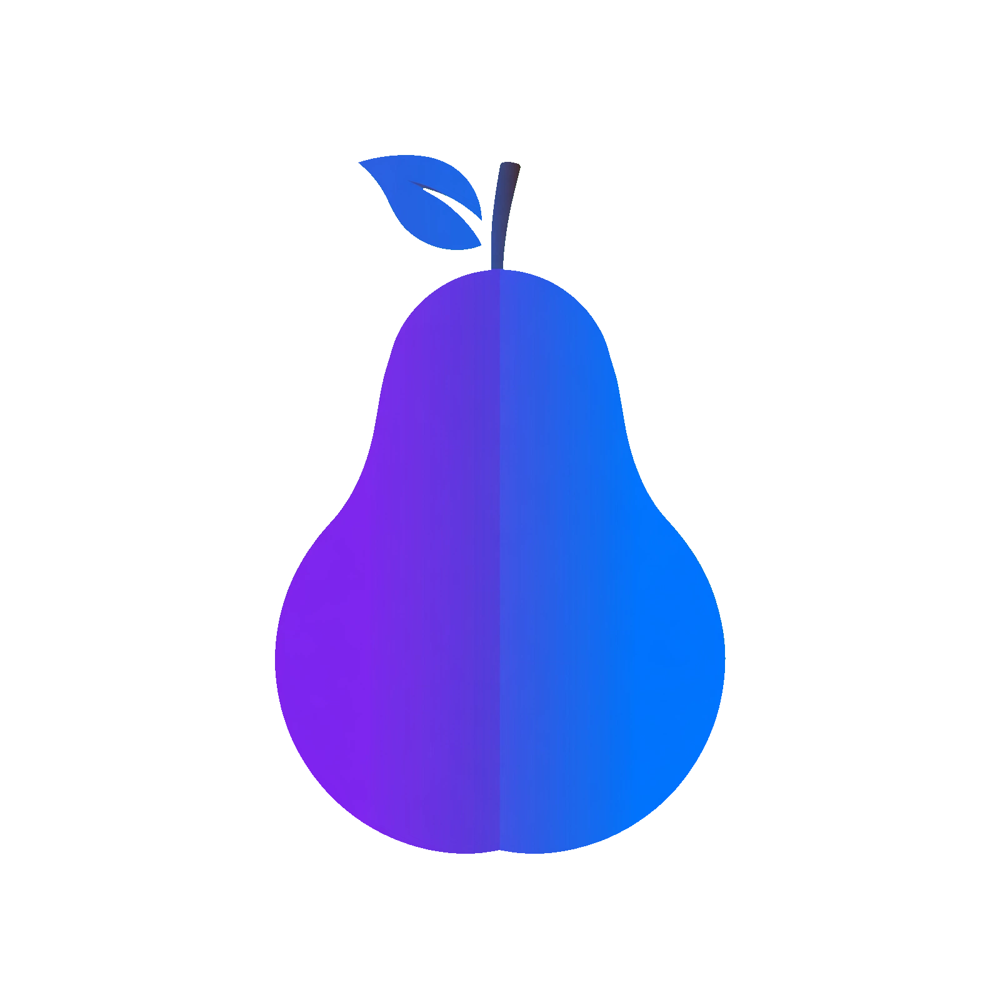

<p align="center">
  
</p>

<h1 align="center">PearSilicon</h1>

<p align="center">
  <strong>One library for iOS apps, Mac apps and Windows games on Apple silicon.</strong>
</p>

<p align="center">
  <a href="https://github.com/denizomer10/PearSilicon/releases"></a>
  <a href="LICENSE"></a>
  
  
  <a href="https://discord.gg/yRVC5ZCyby"></a>
</p>

<p align="center">
  <a href="https://pearsilicon.pages.dev">Website</a> ·
  <a href="https://github.com/denizomer10/PearSilicon/releases">Releases</a> ·
  <a href="docs/CLI.md">CLI</a> ·
  <a href="docs/ARCHITECTURE.md">Architecture</a> ·
  <a href="https://discord.gg/yRVC5ZCyby">Discord</a>
</p>

---

PearSilicon prepares compatible arm64 iOS apps to run through Apple’s Mac
Catalyst and `/System/iOSSupport` frameworks, runs legacy 32-bit (`armv7` /
`armv6`) iOS games via the companion **[PearLegacyEngine](https://github.com/denizomer10/PearLegacyEngine)**
runtime, manages native Mac apps, and runs Windows games in isolated Wine
prefixes. An in-process runtime adds targeted compatibility shims and optional
keyboard, mouse and controller mapping.

It is **not** a full OS virtual machine. Use it only with apps and games you are
authorized to run.

## Highlights

| Platform | What it does |
| --- | --- |
| **iOS Apps (64-bit & 32-bit)** | IPA / device `.app` import; Catalyst runtime shims, performance HUD, pointer lock and opt-in keymapper for 64-bit apps, plus automatic **[PearLegacyEngine](https://github.com/denizomer10/PearLegacyEngine)** execution for 32-bit iOS games |
| **Mac Apps** | Copy-only `.app` import with redirected data, launched natively |
| **Wine Games** | Per-game prefixes, private data, verified engines, DXVK or DXMT graphics |
| **Library** | iOS, Mac and Wine tabs; movable library; per-entry `.pearbackup` backups |
| **Input** | GameController pads, controller/keyboard keymapper, analog right-stick camera |
| **Updates** | Explicit **Check for Updates**, staged verification, development builds |

- **iOS (64-bit):** installs an authorized IPA or `.app`, patches the copy to Mac Catalyst,
  re-signs it, and loads `libPearRuntime.dylib` inside the app process.
- **iOS (32-bit via PearLegacyEngine):** automatically detects 32-bit ARM (`armv7` / `armv6`)
  IPA and `.app` packages (such as *Miku Flick*), installs them cleanly into the
  unified iOS library, and launches them in a game-named macOS `.app` host powered
  by **[PearLegacyEngine](https://github.com/denizomer10/PearLegacyEngine)** with
  SwiftUI controls for free window resizing, fullscreen mode, and save data.
- **Controllers:** Xbox, DualSense/DualShock, Switch Pro and other macOS
  GameController pads are discovered early; non-whitelisted identities are
  normalized, prepared apps receive capability keys, and the keymapper can drive
  touch-only games from pad buttons and sticks.
- **Wine:** self-contained engines, a private prefix per game, a relative `g:`
  drive exposing only the game folder, and no host root (`z:`) mapping.
- **Graphics:** MoltenVK + DXVK 1.10.3 for D3D11, or DXMT on Wine builds that
  export winemac’s Metal view API. Both components are pinned and SHA-256
  verified.
- **Updates:** development builds are published as separate prereleases. If
  GitHub’s unauthenticated API is rate-limited, the updater falls back to the
  public release feed while still checking the asset digest and release commit.

## Requirements

- macOS 26 or later on Apple silicon.
- **Prebuilt app:** no Xcode, Swift or Homebrew required.
- **Source builds:** full Xcode with the macOS 26 SDK.
- Some preparation paths use `otool` and `install_name_tool`; Command Line Tools
  may be required.
- x86_64 Wine engines require Rosetta 2.
- Builds are ad-hoc signed and not notarized; Gatekeeper may ask for approval.

## Install

Download the newest development build from
**[Releases](https://github.com/denizomer10/PearSilicon/releases)**, unzip it,
move `PearSilicon.app` to `/Applications`, and open it.

Each development build is its own prerelease; release notes identify its version,
tested commit and scope. Release notes are written in English by default. If macOS
blocks the first launch, use **System Settings → Privacy & Security → Open Anyway**
or right-click → **Open**.

### Build from source

```sh
./scripts/build-app.sh release     # app + runtime
open build/PearSilicon.app

./scripts/make-zip.sh release      # build/PearSilicon.zip
swift test                         # test suite
./runtime/build.sh                 # runtime dylib only
```

## Quick start

1. Choose **iOS Apps**, **Mac Apps** or **Wine Games** with the platform switch.
2. Click **+** or drop a package:
   - iOS: `.ipa` or iOS device `.app`
   - Mac: native `.app`
   - Wine: game folder or `.exe`, after installing an engine in
     **Settings → Wine**
3. Select the entry to launch, stop, back up or reveal its data.
4. For iOS apps, enable the keymapper in the **Keymap** tab if needed, then
   relaunch.

CLI:

```sh
bin/pearsilicon install ~/Downloads/App.app --launch
bin/pearsilicon launch com.example.app --log
bin/pearsilicon doctor
```

Optional command symlink:

```sh
sudo ln -sf /Applications/PearSilicon.app/Contents/MacOS/PearSilicon \
               /usr/local/bin/pearsilicon
```

Full command reference: [docs/CLI.md](docs/CLI.md).

## 32-bit iOS apps (PearLegacyEngine)

Apps built before iOS 11 (armv6/armv7) cannot be loaded by macOS at all, so
PearSilicon runs them as guest code inside
[PearLegacyEngine](https://github.com/denizomer10/PearLegacyEngine), a 32-bit
iOS compatibility layer built on ANGLE/Metal. Install flow is unchanged: pick the
`.ipa`, nothing else. Such apps are tagged **32-bit** in the library and show
`Runtime: PearLegacyEngine (32-bit iOS)` in the detail view.

One-time engine setup — download the release and place it where PearSilicon
looks for it:

```sh
curl -L -o /tmp/ple.tar.gz \
  https://github.com/denizomer10/PearLegacyEngine/releases/latest/download/PearLegacyEngine-0.7.1-macos-arm64.tar.gz
mkdir -p "$HOME/Library/Application Support/PearSilicon"
tar -xzf /tmp/ple.tar.gz -C "$HOME/Library/Application Support/PearSilicon"
```

The archive extracts as `PearLegacyEngine/`, which is the first location
searched. In a source checkout the engine is also found next to the working
directory, and `PEAR_LEGACY_ENGINE_HOME=/path/to/PearLegacyEngine` overrides
everything. Requirements: Apple Silicon, macOS 26 or later.

Unlike 64-bit apps, the installed `.app` is kept byte-for-byte as shipped — no
platform patch, runtime injection or re-signing — and each app keeps its guest
storage in `Games/<bundleID>`, so saves stay with the library.

## Controllers and keymapper

The keymapper is **opt-in per iOS app** and off by default. Supported actions are
tap, hold, joystick, mouse-look and swipe.

- The Keymap editor has a **Keyboard / Controller** switch. Controller bindings
  can be recorded by pressing A/B/X/Y, shoulders, triggers, D-pad,
  MENU/OPTIONS or a stick, or selected from a menu.
- **L STICK** drives a joystick binding; **R STICK** drives an analog camera
  (60 Hz, dead zone, response curve and adjustable sensitivity).
- If no controller bindings exist, a compatibility fallback maps the standard pad
  to the keyboard keymap. Mapped keyboard events are consumed to suppress the
  system key beep.
- Genshin Impact’s iOS build does not expose its native controller mode on Mac;
  its Control Type remains “Touchscreen”. Controller keymapper bindings still
  drive its touch controls.
- **Keyboard Mouse to Gamepad Inputs** is a separate per-app toggle for games
  with native controller support. The game receives a hidden virtual controller;
  every A/B/X/Y, shoulder, trigger, D-pad, MENU/OPTIONS and stick control can be
  rebound to a key or mouse button, along with the left-stick keys. Click the
  game to capture the mouse and Escape releases it. Mouse sensitivity and an
  invert-vertical-look switch are included. This mode does not use the touch
  keymapper or native pointer lock.

Configure bindings in the in-app **Keymap** tab.

Keyboard keymaps apply to **32-bit iOS games too**. PearSilicon passes the
active keymap to PearLegacyEngine through `PEAR_KEYMAP`, and the engine
synthesises real touches from it (`tap`, `hold`, `swipe` and a dead-zoned
`joystick`), so touch-only legacy titles such as Miku Flick are fully playable
from the keyboard. Bindings with `source: "controller"` stay on the
GameController bridge and are ignored by the engine.

### Performance HUD on 32-bit titles

The **Performance HUD (FPS)** switch in a 32-bit app's settings sets
`PEAR_FPS_HUD=1`, which draws a frame-rate overlay with the engine's own
OpenGL ES renderer. Metal's `MTL_HUD_ENABLED` cannot apply here because these
titles never touch Metal, so the engine draws an equivalent overlay and logs the
same numbers to the app log.

## Automatic compatibility

Older scene-less apps built with an iOS SDK before 15 need a window re-attach
and synthesized touches to receive mouse input. PearSilicon detects this per
game from its `Info.plist` (no scene manifest plus `DTSDKName` major below 15)
and applies the bridges automatically — there is nothing to configure.

The **Compatibility** card on a game's detail page shows the detected profile
and the effective *Window bridge* and *Mouse→touch* state. Existing manual
values are preserved but hidden; when an override is stored, the card offers
**Use automatic**. Automation for scripted setups is available from the CLI:

```sh
pearsilicon compat com.example.game
pearsilicon legacy com.example.game auto
pearsilicon mousetouch com.example.game off
```

## Wine, engines and graphics

Imported games live under `wine-apps/<id>/` with `Payload`, `Data` and `Prefix`.
The prefix is private to the game; absolute host drive mappings are removed.

- Install open-source WineHQ **Staging** or **Development** engines from
  **Settings → Wine**, or register a local runtime.
- Remove a registered engine from Settings; game prefixes and saves are kept.
- Community engines: paste a GitHub repository URL. The newest release archive
  is resolved automatically; if there is no release, the source ZIP is used.
  No manual hash is required; GitHub’s digest is checked when published.
- **DXVK** is pinned to 1.10.3 (Gcenx macOS build) and mirrored into the selected
  game’s prefix; Wine’s files are restored when the backend changes.
- **DXMT** requires a Wine build that exports winemac’s Metal view symbols.
  Automatic Gcenx builds hide them, so the app refuses DXMT there instead of
  opening a black window.

Wine is not a Windows VM. Kernel anti-cheat and kernel drivers are unsupported.

## Updates

**Settings → Updates** has a single **Check for Updates** button and follows the
development channel; there is no Stable selector. Each development build is a
separate prerelease.

The updater verifies the downloaded asset against GitHub’s SHA-256 digest, checks
the embedded `PearBuildCommit` against the release tag, and re-checks the release
before staging. If the GitHub API returns 403/429, it reconstructs the tag,
commit and digest from the public release feed and pages.

## Data and backups

Default support root:

```text
~/Library/Application Support/PearSilicon/
  ios-apps/   mac-apps/   wine-apps/
  Engines/    Keymaps/    Logs/    ODR/    Keychain/    Work/
```

- **Backups:** one `.pearbackup` file per entry, including saves, keychain data,
  ODR and Wine prefixes. Backups are uncompressed, integrity-checked and **not
  encrypted**; treat them as sensitive.
- **Storage:** the library can be moved to another disk from
  **Settings → General → Move Storage…**.
- **iOS data:** `Games/<bundle-id>/Documents`, `Library`, `Library/Caches`,
  `Library/Group Containers` and `tmp`.
- **ODR:** put additional On-Demand Resources in `ODR/<bundle-id>/`.
- **Mac apps:** home, caches, preferences and temp are redirected into the
  entry; absolute host paths remain reachable and no sandbox is claimed.

## Architecture

1. The installer works on a copy: normalizes `Info.plist`, thins universal
   binaries to arm64, sets the Mach-O platform to Mac Catalyst, adds runtime
   dependencies and re-signs.
2. The runtime loads inside the app process. Apple’s `/System/iOSSupport`
   frameworks provide UIKit; the runtime adjusts specific APIs rather than
   replacing UIKit or Metal.
3. Optional shims cover keychain, screen, Metal layer setup, OpenGL ES,
   credentials, cloud surfaces, device identity, paths, pointer lock, ODR,
   audio/haptics, consent, networking and unhandled-key beeps.
4. Wine entries run as direct native processes; no nested sandbox or VM.

See [docs/ARCHITECTURE.md](docs/ARCHITECTURE.md) for the execution model and
[docs/CLI.md](docs/CLI.md) for diagnostics and environment variables.

## Validation

```sh
swift test
python3 scripts/filesystem-smoke.py
python3 scripts/keychain-smoke.py --active-interpose
python3 scripts/runtime-client-smoke.py build/PearSilicon.app/Contents/MacOS/PearSilicon
```

`swift test` covers installer atomicity, archive admission, storage migration,
GUI import routing, portable-library scanning, backup/restore, native Mac launch,
Wine launch planning and update parsing. Optional graphics and external-disk
tests are documented in [docs/TESTING.md](docs/TESTING.md).

A successful launch is not a gameplay-compatibility result. No controlled
benchmark establishes a performance advantage over PlayCover.

## Limitations

- Compatible 64-bit iOS apps still depend on Apple’s Catalyst/iOSSupport stack;
  32-bit apps instead need the PearLegacyEngine bundle installed separately
  (see above).
- The 32-bit engine is Apple Silicon only and needs macOS 26 or later, and its
  app compatibility is narrower than the 64-bit path — one engine release may
  run some games well and crash in others.
- Compatibility varies by app; check release notes rather than assuming a feature
  or game works.
- Mac apps are not sandboxed; Wine cannot run kernel anti-cheat.
- Genshin Impact does not expose a native Controller option on Mac.
- Release digests verify bytes against GitHub metadata; they are not a publisher
  signature. Builds are not notarized.
- Update replacement is refused while a game is running.
- Backups are unencrypted and may contain credentials.

## Community

Questions, setup help and compatibility reports: join the
**[PearSilicon Discord](https://discord.gg/yRVC5ZCyby)**.

When reporting a problem, include the app name/version, macOS version and the
output of `pearsilicon doctor`.

## License

MIT — see [LICENSE](LICENSE). Apple frameworks and installed apps retain their own
licenses. PearSilicon does not provide app licenses, accounts or iOS firmware.
