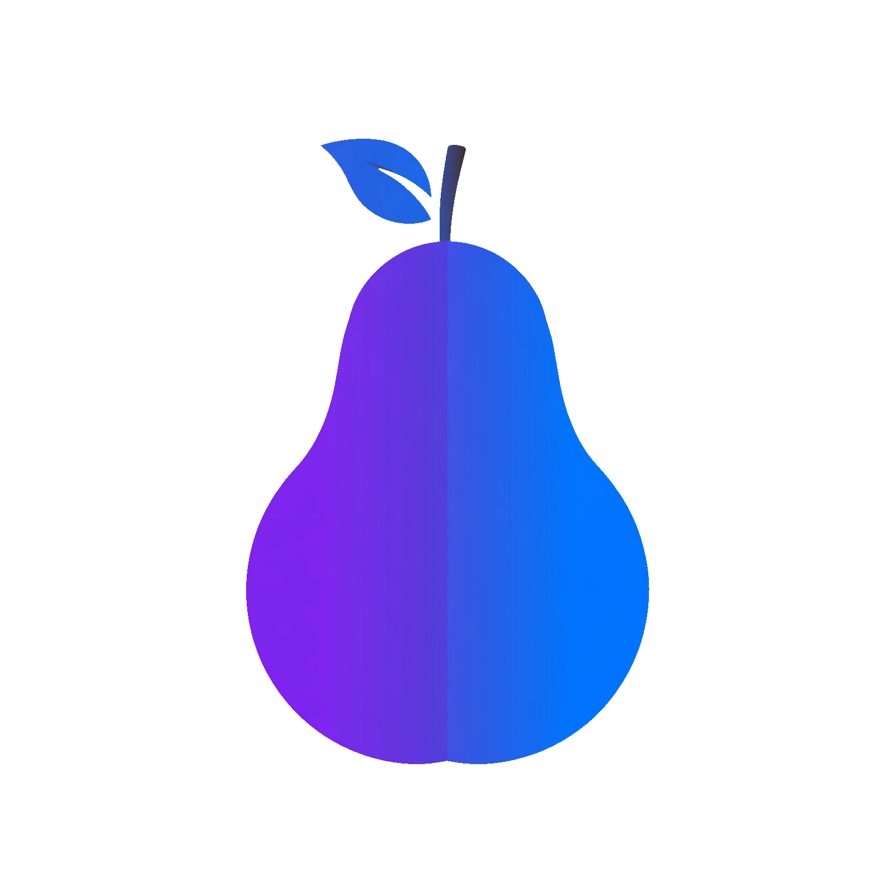

<p align="center">
  
</p>

<h1 align="center">PearSilicon</h1>

<p align="center">
  <strong>One portable library for iOS apps, Mac apps and Wine games.</strong><br>
  Mac Catalyst-based iOS preparation, native Mac app launches, private Wine prefixes and single-file backups.
</p>

<p align="center">
  <a href="https://github.com/denizomer10/PearSilicon/releases"></a>
  <a href="LICENSE"></a>
  
  
  <a href="https://discord.gg/yRVC5ZCyby"></a>
</p>

<p align="center">
  <a href="https://pearsilicon.pages.dev">Website</a>
  &nbsp;·&nbsp;
  <a href="https://github.com/denizomer10/PearSilicon/releases/tag/development-beta">Download</a>
  &nbsp;·&nbsp;
  <a href="docs/CLI.md">CLI reference</a>
  &nbsp;·&nbsp;
  <a href="docs/ARCHITECTURE.md">Architecture</a>
  &nbsp;·&nbsp;
  <a href="#community">Community</a>
  &nbsp;·&nbsp;
  <a href="https://discord.gg/yRVC5ZCyby">Discord</a>
</p>

---

PearSilicon prepares compatible arm64 iOS applications to run on macOS using
Apple's Mac Catalyst and `/System/iOSSupport` frameworks. Its in-process runtime
adds compatibility shims and optional keyboard/mouse mapping on top of that
Apple-provided environment. It is not a standalone reimplementation of iOS or
UIKit. The same app also manages native Mac apps and Windows games through Wine.
Use it only with applications you are authorized to run.

> **Feature branch status:** the three-platform library, single-file backups,
external-library support, updater and Wine/Mac app management described here are
currently in a separate feature branch. They are **not** part of the published
`development-beta` or stable releases until they have been reviewed and tested
further. Published artifacts keep their own release notes and tested commit.

| | |
| :--- | :--- |
| **iOS Apps** | `.ipa` / iOS `.app` preparation, opt-in keymapper, Metal HUD, pointer lock |
| **Mac Apps** | Copy-only `.app` import, private data directory, direct native launch |
| **Wine Games** | Per-game prefix, private data, automatic open-source WineHQ engines |
| **Library** | `ios-apps`, `mac-apps`, `wine-apps`; attach or move a whole library to an external disk |
| **Backups** | One `.pearbackup` file per app or game, including saves, keychain data, ODR and prefixes |
| **Updates** | Explicit GitHub release check, verified staging and atomic relaunch helper |

## Release channels

This README describes current development source, which can be newer than a
published download. Choose an artifact by its release notes rather than assuming
that every feature on this page is included in every version.

The recommended download is the
**[development beta](https://github.com/denizomer10/PearSilicon/releases/tag/development-beta)**,
a prerelease updated in place. Its notes identify the artifact's last tested
commit and the exact scope of those checks. This is not a stable-release promise
or a verified catalog of playable games.

IPA/`.app` package drop handling, host/environment injection and storage
relocation are current development features. Consult the beta's artifact notes: source changes
can be newer than the published ZIP.

## Features

- Three library tabs with a Liquid Glass switch: **iOS Apps**, **Mac Apps** and **Wine Games**.
- Install IPA archives and iOS device `.app` bundles through the GUI or CLI.
- Native Mac `.app` import without patching or re-signing. Apps launch **directly
  and natively** from the managed copy with HOME, CFFIXED_USER_HOME and TMPDIR
  redirected into the entry's `Data` folder. There is no VM or emulation layer;
  absolute host paths remain reachable by the app.
- Windows games run in per-game Wine prefixes with isolated data. Host `z:` and
  absolute drive links are removed and the process is sandboxed.
- Automatically fetch the latest open-source WineHQ **Stable**, **Staging** or
  **Development** build published for macOS by `Gcenx/macOS_Wine_builds`. GitHub's
  SHA-256 is mandatory, archives are path-admitted before extraction, and the
  runtime is installed without a second full copy. Local open-source engines can
  still be registered manually. GPTK is no longer supported or offered.
- Keymapper, opt-in per iOS app and off by default: tap, hold, joystick, mouse-look
  and swipe. Mac and Wine entries do not use the iOS keymapper.
- Per-app Metal HUD and pointer-lock controls for iOS; Metal HUD for managed entries.
- Mandatory repeat-rate protection in the keymapper.
- Local compatibility shims for keychain, screen, Metal, OpenGL, cloud, device,
  paths, on-demand resources, consent and networking.
- Single-file `.pearbackup` backups for every platform. Backups are uncompressed,
  integrity-checked and **not encrypted**; they can contain credentials.
- Verified update staging with an atomic relaunch helper and rollback copy.
- MIT-licensed.

## Requirements

- macOS 26 or later
- an arm64 Mac
- **Prebuilt app:** opening the GUI does not require Xcode, Swift, Homebrew or a
  source checkout. The release bundle includes PearSilicon's runtime libraries;
  Apple's compatibility frameworks are supplied by macOS.
- **App preparation and relocation:** some paths invoke `otool` and
  `install_name_tool` and require Apple's Command Line Tools. Installation is
  therefore not guaranteed to be tool-free on a clean Mac.
- **Source/project builds:** select a full Xcode toolchain. The runtime-only
  build can use Command Line Tools with a macOS SDK containing iOSSupport.

Current development builds are ad-hoc signed, not Developer ID-signed or
notarized, so downloaded copies may require explicit Gatekeeper approval.
`pearsilicon doctor` reports build-tool availability, runtime location and
library status; it does not certify game compatibility.

## Gatekeeper, signing and notarization

An ad-hoc build is not a malware verdict, but macOS cannot verify its publisher.
This project does **not** silently bypass that protection.

- **Local builds:** `scripts/build-app.sh` removes stale quarantine flags from
  the build output. A locally built app normally opens without a download prompt.
- **Downloaded PearSilicon:** approve it once in **System Settings → Privacy &
  Security → Open Anyway**, or right-click the app and choose **Open**. For a
  local test copy only, `xattr -dr com.apple.quarantine /Applications/PearSilicon.app`
  removes the flag.
- **Imported Mac apps:** if the original download is quarantined, the managed
  copy keeps that flag. Open the app's detail pane and use **Allow This App…**
  only if you trust the source. This affects that imported copy only and does not
  notarize it.
- **No-warning distribution:** requires an Apple Developer Program membership, a
  **Developer ID Application** certificate, hardened-runtime signing and Apple
  notarization. Prepare credentials once with `xcrun notarytool store-credentials`,
  then run:

  ```sh
  PEAR_SIGN_IDENTITY="Developer ID Application: Name (TEAMID)" \
  PEAR_NOTARY_PROFILE="pearsilicon-notary" \
  ./scripts/notarize.sh build/PearSilicon.app
  ```

  The script signs nested dylibs/frameworks, submits with `notarytool --wait`,
  staples the ticket and runs a Gatekeeper assessment. It cannot create a
  certificate or enroll an account for you. Notarization covers PearSilicon; we
  cannot notarize a third-party app such as FH2 Port on its publisher's behalf.

## Install and run

1. Download the [development beta](https://github.com/denizomer10/PearSilicon/releases/tag/development-beta),
   or build the app yourself. The beta is updated in place; its
   notes identify the last tested commit and the scope of those checks.
2. Unzip the download, move `PearSilicon.app` to `/Applications` and open it.
3. Use the top switch to choose a platform. Click **+** or drop a package:
   - **iOS Apps:** `.ipa` or iOS device `.app`
   - **Mac Apps:** native macOS `.app`
   - **Wine Games:** a program folder or `.exe`, after registering a Wine engine
     in **Settings → Wine**
4. Select an item to launch, stop, back up, reveal its data, or remove it.
5. Use **Backup** to write one `.pearbackup` file and **Restore** (or **Restore and
   Replace Existing**) to bring it back.

The same installer and launcher are available from a terminal:

```sh
bin/pearsilicon install ~/Downloads/App.app --launch
bin/pearsilicon launch com.example.app --log
bin/pearsilicon doctor
```

After installing the app, link the command once:

```sh
sudo ln -sf /Applications/PearSilicon.app/Contents/MacOS/PearSilicon \
               /usr/local/bin/pearsilicon
```

Full command reference: [docs/CLI.md](docs/CLI.md).

Before installation, the full bundle is checked for supported ARM64/platform
metadata and encrypted or malformed Mach-O images. CRC-damaged archives are
rejected. Failed staged preparation/signing leaves an existing installation in
place. This does not decrypt code or guarantee working gameplay.

For read-only checks use `pearsilicon validate <App.app|Mach-O>`; see
[startup diagnostics](docs/STARTUP_DIAGNOSTICS.md), including the limits of the
Genshin/Telemetry SIGILL investigation. Previously prepared copies whose
`cryptid` was cleared need a fresh verified input; they cannot be repaired by
merely updating the launcher.

## Validation

PearSilicon is tested in layers rather than by a single "game works" claim:

```sh
swift test
python3 scripts/filesystem-smoke.py
python3 scripts/keychain-smoke.py --active-interpose
python3 scripts/runtime-client-smoke.py <path-to-PearSilicon-executable>
python3 scripts/e2e-games.py --cli <path-to-PearSilicon-executable> --stress
```

`swift test` covers installer atomicity, archive admission, stopped-app leases,
storage migration, GUI import routing/FIFO/cancellation, portable library
scanning, backup/restore round trips, native Mac launches, the fake-Wine
prefix/launch path and update parsing. The runtime suites use temporary data and
exercise permissions, keychain generation, IPC deadlines and cloud-identity
compatibility. External-volume migration has an opt-in real-disk test:

```sh
PEAR_EXTERNAL_TEST_DIR=/Volumes/YourDisk swift test --filter ExternalDiskStorageTests
```

The background app check launches only apps it started, skips already-running
apps, and verifies process liveness, clean shutdown, duplicate-launch rejection
and the absence of runtime signal/exception markers. It does not verify gameplay,
input coordinates, downloads or account flows. See
[Testing and validation](docs/TESTING.md) for the exact scope and manual checklist.

## Build

```sh
./scripts/build-app.sh          # app + runtime (full toolchain)
open build/PearSilicon.app

./scripts/make-zip.sh           # build/PearSilicon.zip

swift build
swift test
./runtime/build.sh              # runtime dylib only (Command Line Tools work)

# Package elsewhere without replacing an app currently open from build/:
PEAR_BUILD_DIR=.build/package-check ./scripts/make-zip.sh
```

## How it works

1. The installer works on a copy: it normalizes `Info.plist`, thins supported
   universal binaries to `arm64`, patches Mach-O platform metadata to
   **Mac Catalyst (6)**, adds compatibility dependencies, and re-signs the copy.
   The input IPA is not changed; the installed app is modified.
2. By default, `LC_LOAD_DYLIB` loads `libPearRuntime.dylib` **inside the app's
   process**. Experimental `--env-injection` uses launcher-provided
   `DYLD_INSERT_LIBRARIES` to load the **same full runtime**, not selected shims.
3. The launcher uses Apple's `/System/iOSSupport` frameworks, including UIKit.
   Normal launches use LaunchServices; `--background` avoids requesting focus.
4. Runtime hooks adjust specific API behavior and, when enabled, map input.
   They do not replace UIKit, the kernel, or the app's Metal renderer.

The experimental [host-service split](docs/CLI.md#experimental-host-service-split)
moves only local key-value backing state and static device-profile configuration
to a separate process. UIKit, input, rendering, audio, device API hooks and
keychain handling remain in-process. This is not kernel-level iOS emulation or
a security sandbox for untrusted apps.

See [Architecture](docs/ARCHITECTURE.md) for the execution model, its limited
Wine/Proton analogy and the scope of comparisons with PlayCover. No controlled
benchmarks currently establish lower memory/CPU use, higher FPS or lower latency
than PlayCover. A successful launch check is not a gameplay compatibility result.

### Mac apps

A native `.app` is copied into `mac-apps/<bundle-id>/Payload` without patching or
re-signing. Its `HOME`, `CFFIXED_USER_HOME`, `TMPDIR`, caches and preferences are
redirected into the entry, then the app is launched directly as a native macOS
process. There is no virtual machine, Wine layer or `sandbox-exec` wrapper. This
means the app can still reach absolute host paths; the feature is for central
organization, portable data and one-click backups, not security isolation.

### Wine games

Windows entries live in `wine-apps/<id>/` with `Payload`, `Data` and `Prefix`.
Each game gets its own prefix, and host drive mappings are removed before the
game starts. **Settings → Wine** checks the public release feed for the latest
open-source WineHQ build and installs it after SHA-256 verification and safe
tar-path admission. The macOS builds are currently `osx64`, so Apple silicon may
need Rosetta 2. Wine is not a Windows VM; anti-cheat and kernel drivers are not
supported. Local open-source runtimes can still be registered manually.

### Portable library

```
~/Library/Application Support/PearSilicon/
  ios-apps/<bundle-id>.app
  mac-apps/<bundle-id>/
  wine-apps/<id>/
  Engines/
  Keymaps/  Logs/  ODR/  Keychain/  Work/
```

Only the folder for a platform with at least one item is created. Existing apps
in the legacy `Applications/` folder are still listed and used. A folder with the
`.pear-storage-root` marker can be opened in place (**Settings → Library → Open
Existing Library…**) or the whole root can be moved to another disk. Moving
copies and verifies the tree, rewrites iOS load paths, and keeps the previous copy
for rollback.

### Compatibility shims

| Shim | Purpose |
| --- | --- |
| `KeychainShim` | local keychain store and software key generation |
| `ScreenShim` | make `UIScreen` follow the key window |
| `MetalLayerShim` | fix existing Metal device/layer/drawable and texture setup; not a replacement renderer |
| `GLShim` | OpenGL ES entry point and drawable fitting |
| `CredentialShim` | safe client-credential handling |
| `CloudShim` | local-only key-value, ubiquity, CloudKit and GameKit surface |
| `DeviceShim` | coherent device identity |
| `PathShim` | redirect supported home, group-container and temporary-directory APIs; not filesystem isolation |
| `PointerLockShim` | per-app pointer-lock control |
| `ODRShim` | resolve packaged and user-supplied on-demand resources |
| `ServicesShim` | audio-session, haptics, store availability, remote-notification and background-task surfaces |
| `ConsentShim` | local consent entry points |
| `NetworkShim` | iOS-style request identity and HTTP/2 |
| `BeepShim` | silence the alert beep for unhandled keys |
| `libswiftUIKit` | source-built Swift UIKit compatibility overlay |

Opt-outs are shim-specific, for example `PEAR_NO_METAL_FIX=1` and
`PEAR_NO_CLOUD_SHIM=1`. Not every component has a matching `PEAR_NO_*` switch;
consult its source before using an override.

## App data

The default runtime data location is:

```
~/Library/Application Support/PearSilicon/Games/<bundle-id>/
  Documents/  Library/  Library/Caches/  Library/Group Containers/  tmp/
```

The launcher supplies `PEAR_HOME_DIR` for the app's data directory and
`PEAR_SUPPORT_ROOT`, `PEAR_KEYCHAIN_DIR` and `PEAR_ODR_PATH` for other managed
paths. It may reuse an existing macOS container when that contains the app's
previous data. `PEAR_HOME_DIR` alone does not move the library or all other stores.

Storage relocation is available in **Settings → General → Move Storage…** and
`pearsilicon storage move <folder>`. Launch moved games through PearSilicon:
direct Finder launches do not infer the selected storage root. The previous copy
is kept until removed. The move path has an opt-in real external APFS test; see
[storage location](docs/CLI.md#storage-location).

Some apps keep content in On-Demand Resources that their package does not
carry. Put those bundles in the per-app ODR folder:

```
~/Library/Application Support/PearSilicon/ODR/<bundle-id>/
```

The folder accepts flat bundle files or a copy of the Addressables tree with a
`BuildTarget/` subdirectory. At launch the runtime merges these with packaged
bundles using symlinks where possible, falling back to copying if symlink creation
fails. Override the folder with `PEAR_ODR_PATH=<dir>`.

## Per-app options

- **Metal HUD** — launches with `MTL_HUD_ENABLED=1`.
- **Pointer lock** — on by default; disable it if the cursor gets trapped.
- **iOS-like container** — part of the base environment and applied to every
  launch; there is no per-app switch.

Repeat-rate protection is always on and not configurable.

## Keymapper

The keymapper is opt-in and off by default. It can record a physical key, add a
tap, hold, joystick, mouse-look or swipe binding, and clear all bindings. Saved
binding edits can reload while the keymapper is active. Enabling or disabling
the keymapper takes effect on the next launch.

A keymap is a JSON file per app. This complete format includes the metadata and
binding IDs required by GUI/CLI import; adapt the bundle ID and coordinates to
your app, or generate a starter map with `pearsilicon keymap <id> --generate`:

```json
{
  "version": 1,
  "bundleID": "com.example.app",
  "engine": "unknown",
  "isAutoGenerated": false,
  "createdAt": "2026-10-30T00:00:00Z",
  "bindings": [
    {
      "id": "8C2A9D40-6A89-4BFE-B3F7-90F7C3A26D91",
      "key": "wasd",
      "action": { "joystick": { "center": { "x": 0.14, "y": 0.72 }, "radius": 0.1 } }
    },
    {
      "id": "533090C0-D5BF-44C5-921F-FA14154260CB",
      "key": "space",
      "action": { "tap": { "_0": { "x": 0.9, "y": 0.82 } } }
    }
  ]
}
```

## Diagnostics

- `PEAR_LOG_FILE=<path>` writes the runtime log to a file.
- Launcher-managed compatibility launches enable an iOS-like filesystem view
  through hooks and request a permissive macOS sandbox profile. This is not iOS
  kernel emulation or secure per-app isolation.
- `PEAR_ODR_PATH=<dir>` overrides the per-app folder for On-Demand Resources.
- `PEAR_DEBUG_SERVICES=1` logs the installed service surfaces.
- `PEAR_DEBUG_TOUCH`, `PEAR_DEBUG_SCREEN`, `PEAR_DEBUG_GL` and
  `PEAR_DEBUG_CLOUD` add logging.
- Supported `PEAR_NO_*` variables opt out of specific hooks; names and behavior vary.
- `PEAR_DISABLE=1` skips the main runtime bootstrap, including the keymapper;
  separate shim initializers can still run. It is not a global no-hooks mode.
- `pearsilicon doctor` reports build tools, runtime location and library status.

## Scope and limitations

- iOS apps still depend on Apple's Mac Catalyst/`/System/iOSSupport` stack. No
  kernel-level iOS emulation or full UIKit reimplementation is provided.
- Mac apps run natively; `HOME` and temp data are redirected, but absolute host
  paths remain reachable and no filesystem sandbox is claimed. Wine is not a
  Windows VM and cannot run kernel anti-cheat.
- Backups are unencrypted. The keychain and app data included in a backup may be
  sensitive; store the file accordingly.
- GitHub release digests verify downloaded bytes against GitHub metadata. They
  are not a publisher signature. Builds are ad-hoc signed and not notarized.
- Update replacement is refused while any game is running. The previous app is
  left as a visible rollback copy beside the installed bundle.
- No controlled benchmark establishes a performance advantage over PlayCover.

## Scope and licensing

PearSilicon's source is MIT-licensed. It depends on Apple frameworks supplied by
macOS; those frameworks and the apps you install retain their respective licenses.
The project is intended for interoperability and educational use with apps you
are authorized to run. It does not provide app licenses, accounts or iOS firmware.

## Community

Questions, setup help, compatibility reports and development discussion live on
Discord:

**[Join the PearSilicon Discord →](https://discord.gg/yRVC5ZCyby)**

When reporting a problem, please include the app name and version, your macOS
version and the output of `pearsilicon doctor` — that makes it much easier to
reproduce and fix.

## License

MIT — see [LICENSE](LICENSE).
